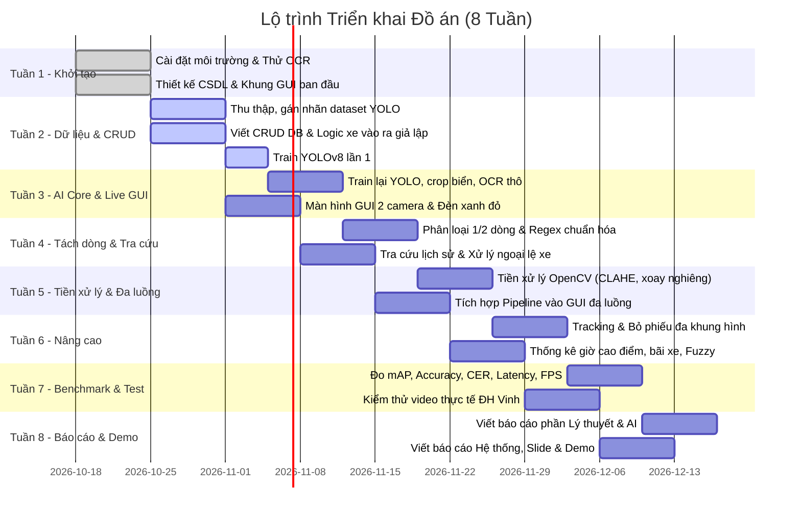

# DANH SÁCH GITHUB ISSUES - DỰ ÁN HỆ THỐNG QUẢN LÝ XE RA VÀO ĐẠI HỌC VINH

> **Đề tài**: Hệ thống Quản lý Xe Ra Vào Đại học Vinh bằng Thị giác Máy tính (Hướng tới Khuôn viên Thông minh)  
> **Phân công**: Thành viên A (AI & Computer Vision Core) | Thành viên B (Database, Business Logic & GUI)  
> **Thời gian thực hiện**: 8 Tuần

---

## 📌 BẢNG TỔNG HỢP BACKLOG & ROADMAP 8 TUẦN

---

## 🚀 CHI TIẾT TỪNG GITHUB ISSUE

### [ISSUE-01] Setup môi trường phát triển & Cấu hình VSCode cho dự án
* **Người phụ trách**: Thành viên A & Thành viên B
* **Thời hạn (Deadline)**: Cuối Tuần 1 (Đã hoàn thành)
* **Mô tả công việc & Nghiệp vụ**:
  * Khởi tạo virtual environment Python 3.12 (`.venv`).
  * Cài đặt PyTorch với CUDA 12.4 nhận diện GPU rời NVIDIA RTX 4050.
  * Cài đặt các thư viện lõi: `ultralytics` (YOLOv8), `paddlepaddle==2.6.2`, `paddleocr==2.8.1`, `opencv-contrib-python`, `PyQt6`, `customtkinter`.
  * Cấu hình `.vscode/settings.json`, `.vscode/launch.json` và xử lý triệt để mã hóa UTF-8 tiếng Việt.
* **Tiêu chí hoàn thành (Acceptance Criteria)**:
  - [x] Tạo thành công `.venv` và file `requirements.txt`.
  - [x] Chạy script `scripts/verify_env.py` đạt 100% PASS trên tất cả các module.
  - [x] Không còn lỗi type-checking trên VSCode (Pylance).

---

### [ISSUE-02] Thiết kế Lược đồ Cơ sở dữ liệu & Xây dựng tầng CRUD
* **Người phụ trách**: Thành viên B
* **Thời hạn (Deadline)**: Cuối Tuần 1 - Đầu Tuần 2
* **Mô tả công việc & Nghiệp vụ**:
  * Thiết kế kiến trúc CSDL (SQLite phục vụ thử nghiệm nội bộ, hỗ trợ mở rộng sang MySQL / SQL Server).
  * Xây dựng các bảng dữ liệu:
    1. `Vehicles`: Quản lý danh sách xe đăng ký trước (biển số, chủ xe, mã sinh viên/giảng viên, loại xe máy/ô tô, trạng thái vé tháng/vé VIP).
    2. `Transactions` (Logs): Lưu vết từng lượt xe vào/ra (mã giao dịch, biển số nhận diện vào, biển số nhận diện ra, thời gian vào, thời gian ra, đường dẫn ảnh chụp xe/biển số, trạng thái: `IN_PARKING`, `COMPLETED`, `FLAGGED_MISMATCH`).
    3. `ParkingSlots`: Thống kê tổng số chỗ đỗ, số lượng xe hiện đang trong khuôn viên trường.
  * Xây dựng lớp `DatabaseManager` với các phương thức CRUD chuẩn (Thêm xe, Ghi nhận xe vào, Cập nhật xe ra, Đếm xe đang đỗ, Tìm kiếm lịch sử).
* **Tiêu chí hoàn thành (Acceptance Criteria)**:
  - [ ] File schema `src/database/models.py` và `src/database/db_manager.py` hoạt động không lỗi.
  - [ ] Có script kiểm thử `tests/test_database.py` tạo dữ liệu giả lập và truy vấn CRUD thành công.

---

### [ISSUE-03] Khảo sát thực địa, Thu thập Video & Hình ảnh tại Cổng trường ĐH Vinh
* **Người phụ trách**: Thành viên A (Thành viên B hỗ trợ)
* **Thời hạn (Deadline)**: Cuối Tuần 2
* **Mô tả công việc & Nghiệp vụ**:
  * Khảo sát vị trí đặt camera thực tế tại các cổng trường Đại học Vinh (Cổng chính Lê Duẩn, cổng phụ): độ cao 1.5m - 2.5m, góc nhìn nghiêng 15° - 30°.
  * Thu thập dữ liệu video thực tế trong nhiều điều kiện:
    * Giờ cao điểm (sáng 6h45 - 7h30, trưa 11h30 - 12h15) và giờ thấp điểm.
    * Đủ cả 2 loại phương tiện: Ô tô (biển 1 dòng dài/vuông) và Xe máy (biển 2 dòng).
    * Các trường hợp khó: biển số mờ, trầy xước, dính bùn đất, góc nghiêng lớn, ngược sáng hoặc ánh sáng yếu buổi tối có đèn xe chiếu rọi.
  * Tách frame video thành tập ảnh thô lưu tại `data/raw/`.
* **Tiêu chí hoàn thành (Acceptance Criteria)**:
  - [ ] Thu thập tối thiểu 5-10 đoạn video ngắn chất lượng Full HD tại các thời điểm khác nhau.
  - [ ] Trích xuất được tối thiểu 800 - 1500 ảnh thô chứa phương tiện ra vào cổng trường.

---

### [ISSUE-04] Gán nhãn dữ liệu Biển số xe & Tăng cường dữ liệu (Data Augmentation)
* **Người phụ trách**: Thành viên A (Thành viên B hỗ trợ)
* **Thời hạn (Deadline)**: Cuối Tuần 2
* **Mô tả công việc & Nghiệp vụ**:
  * Sử dụng Roboflow / LabelImg / CVAT để gán nhãn bounding box vùng chứa biển số (`license-plate`) theo format YOLO (`.txt` chứa `class_id x_center y_center width height`).
  * Phân chia tập dữ liệu thành `train` (70%), `val` (20%), `test` (10%).
  * Áp dụng kỹ thuật Augmentation (Albumentations/Roboflow): xoay nhẹ (-10° đến +10°), thay đổi độ sáng/tương phản giả lập thời tiết nắng/mưa, thêm blur/noise nhẹ.
* **Tiêu chí hoàn thành (Acceptance Criteria)**:
  - [ ] Bộ dataset hoàn chỉnh đặt tại `data/datasets/license_plate/` với cấu trúc `images/train`, `labels/train`, `images/val`, `labels/val`, `data.yaml`.
  - [ ] Dataset có tối thiểu 1000 ảnh đã gán nhãn chuẩn xác, không bị lỗi lệch bounding box.

---

### [ISSUE-05] Xây dựng Khung Giao diện Giám sát ban đầu (GUI Skeleton & Mock API)
* **Người phụ trách**: Thành viên B
* **Thời hạn (Deadline)**: Cuối Tuần 2
* **Mô tả công việc & Nghiệp vụ**:
  * Thiết kế giao diện ứng dụng quản trị máy trạm chốt trực (sử dụng `PyQt6` hoặc `customtkinter`).
  * Bố cục layout gồm:
    * Vùng 1: Video stream hiển thị song song 2 camera (Làn vào bên trái, Làn ra bên phải).
    * Vùng 2: Khung thông tin biển số vừa nhận diện + ảnh crop biển số phóng to.
    * Vùng 3: Bảng danh sách xe vừa quét qua gần nhất.
    * Vùng 4: Thẻ trạng thái thống kê nhanh (Số xe hiện có trong bãi, Tổng lượt trong ngày).
  * Chạy thử nghiệm giao diện với dữ liệu giả lập (Mock data / ảnh tĩnh).
* **Tiêu chí hoàn thành (Acceptance Criteria)**:
  - [ ] Giao diện khởi động mượt mà không vỡ layout ở độ phân giải màn hình phổ thông (1920x1080, 1366x768).
  - [ ] Các widget cơ bản hiển thị đúng vị trí theo thiết kế.

---

### [ISSUE-06] Huấn luyện Mô hình YOLOv8 Phát hiện Biển số xe (Plate Detection)
* **Người phụ trách**: Thành viên A
* **Thời hạn (Deadline)**: Giữa Tuần 3
* **Mô tả công việc & Nghiệp vụ**:
  * Viết script huấn luyện `src/core/train_detector.py` sử dụng `ultralytics.YOLO`.
  * Tận dụng GPU rời RTX 4050 (batch size 16 hoặc 32, epochs 50 - 100, image size 640).
  * So sánh mô hình `yolov8n` (nano) và `yolov8s` (small) để tối ưu giữa tốc độ FPS và độ chính xác mAP.
  * Xuất file trọng số `models/yolov8_plate_best.pt`.
* **Tiêu chí hoàn thành (Acceptance Criteria)**:
  - [ ] Mô hình đạt chỉ số mAP@0.5 >= 95% và mAP@0.5:0.95 >= 75% trên tập validation.
  - [ ] Tốc độ suy luận (Inference time) trên GPU đạt <= 15 - 20ms/frame.
  - [ ] Lưu lại biểu đồ huấn luyện (`loss.png`, `PR_curve.png`, `confusion_matrix.png`).

---

### [ISSUE-07] Xây dựng Module Crop & Tiền xử lý Ảnh Biển số với OpenCV
* **Người phụ trách**: Thành viên A
* **Thời hạn (Deadline)**: Cuối Tuần 3
* **Mô tả công việc & Nghiệp vụ**:
  * Xây dựng module `src/core/preprocessor.py`:
    * Cắt (crop) vùng biển số từ bounding box do YOLO phát hiện với padding an toàn (khoảng 3-5px tránh mất nét viền).
    * Thuật toán cân chỉnh góc nghiêng (Skew correction / Perspective Transform) nếu xe vào chéo góc.
    * Áp dụng kỹ thuật tăng cường độ tương phản cục bộ thích ứng CLAHE (`cv2.createCLAHE`).
    * Khử nhiễu ảnh và chuyển đổi ảnh nhị phân (Adaptive Thresholding / Otsu) để tối ưu cho OCR.
* **Tiêu chí hoàn thành (Acceptance Criteria)**:
  - [ ] Hàm `preprocess_plate(plate_crop)` nhận ảnh thô và trả về ảnh đã được làm rõ nét, thẳng hàng.
  - [ ] Thử nghiệm trên 20 ảnh biển số thực tế góc nghiêng / thiếu sáng cho kết quả trực quan rõ ràng hơn ảnh gốc.

---

### [ISSUE-08] Tích hợp PaddleOCR Nhận dạng Ký tự Biển số 1 Dòng & 2 Dòng
* **Người phụ trách**: Thành viên A
* **Thời hạn (Deadline)**: Đầu Tuần 4
* **Mô tả công việc & Nghiệp vụ**:
  * Xây dựng module `src/core/ocr_engine.py` tích hợp PaddleOCR.
  * Thuật toán phân loại và xử lý 2 dạng biển số Việt Nam:
    * **Biển 1 dòng (Ô tô)**: Đọc chuỗi ký tự theo thứ tự ngang.
    * **Biển 2 dòng (Xe máy)**: Xác định vị trí bounding box của các ký tự theo trục Y để chia thành Dòng trên (Mã tỉnh + Seri chữ cái: ví dụ `37-B1`) và Dòng dưới (Dãy số thứ tự: ví dụ `123.45`), sau đó ghép lại theo thứ tự logic đúng `37B112345`.
* **Tiêu chí hoàn thành (Acceptance Criteria)**:
  - [ ] Nhận dạng chính xác cả biển số 1 dòng và 2 dòng.
  - [ ] Không bị đảo ngược dòng trên và dòng dưới trên biển số xe máy.

---

### [ISSUE-09] Xây dựng Module Hậu xử lý & Chuẩn hóa Chuỗi bằng Regex
* **Người phụ trách**: Thành viên A
* **Thời hạn (Deadline)**: Cuối Tuần 4
* **Mô tả công việc & Nghiệp vụ**:
  * Xây dựng module `src/core/postprocessor.py`:
    * Xây dựng bộ biểu thức chính quy (Regex Pattern) chuẩn theo quy định biển kiểm soát xe cơ giới Việt Nam:
      * Xe máy: `^\d{2}[A-Z]\d{5,6}$` hoặc `^\d{2}[A-Z]{2}\d{5,6}$` (ví dụ `37B112345`, `37AA12345`).
      * Ô tô cá nhân / cơ quan: `^\d{2}[A-Z]\d{4,5}$` (ví dụ `37A12345`).
    * Thuật toán sửa lỗi nhầm lẫn OCR dựa trên vị trí ký tự:
      * Vị trí 2 ký tự đầu: bắt buộc là số (mã tỉnh 11-99), nếu OCR đọc ra `B`, `D`, `Z` thì tự động sửa thành `8`, `0`, `2`.
      * Vị trí seri chữ cái: nếu OCR đọc ra `8`, `0`, `1` thì tự động sửa thành `B`, `D`/`O`, `I`.
      * Dãy số cuối: bắt buộc là chữ số.
* **Tiêu chí hoàn thành (Acceptance Criteria)**:
  - [ ] Hàm `clean_license_plate(raw_text)` sửa thành công 100% các ca nhầm lẫn cơ bản (ví dụ: `37B1-I23.45` -> `37B112345`, `37A-I23.4B` -> `37A12348`).
  - [ ] Trả về chuỗi chuẩn hóa không chứa ký tự lạ, dấu gạch nối hay chấm lửng.

---

### [ISSUE-10] Xây dựng Logic Nghiệp vụ Kiểm soát Xe Vào / Ra & Xử lý Ngoại lệ
* **Người phụ trách**: Thành viên B
* **Thời hạn (Deadline)**: Cuối Tuần 4
* **Mô tả công việc & Nghiệp vụ**:
  * Xây dựng module `src/database/business_logic.py`:
    * **Luồng xe vào (In-flow)**: Nhận biển số từ camera vào -> Kiểm tra xe trong danh sách đăng ký -> Lưu ảnh và tạo lượt giao dịch trong CSDL -> Trả về lệnh MỞ BARRIER VÀO.
    * **Luồng xe ra (Out-flow)**: Nhận biển số từ camera ra -> Truy vấn lượt vào gần nhất của xe này trong CSDL -> So khớp biển số vào và ra:
      * Nếu trùng khớp: Báo hợp lệ, cập nhật giờ ra, tính thời gian đỗ, lệnh MỞ BARRIER RA.
      * Nếu không khớp / không tìm thấy lượt vào: Kích hoạt CẢNH BÁO ĐỎ cho bảo vệ kiểm tra trực tiếp.
    * **Xử lý ngoại lệ**:
      * Xe vào 2 lần liên tiếp mà chưa có lượt ra.
      * Biển số không nhận dạng được (ảnh mờ, biển bị che): Cho phép bảo vệ nhập tay (Manual Override).
* **Tiêu chí hoàn thành (Acceptance Criteria)**:
  - [ ] Hoàn thành trọn vẹn state machine xử lý luồng xe vào và ra.
  - [ ] Có bộ unit test mô phỏng các kịch bản ngoại lệ (xe lạ, xe chưa vào đã đòi ra, biển số sai lệch).

---

### [ISSUE-11] Hoàn thiện Màn hình GUI Giám sát Trực tiếp 2 Làn (Camera In/Out & Đèn Xanh/Đỏ)
* **Người phụ trách**: Thành viên B
* **Thời hạn (Deadline)**: Cuối Tuần 4
* **Mô tả công việc & Nghiệp vụ**:
  * Tích hợp khung video hiển thị trực tiếp camera Làn Vào và Làn Ra.
  * Hiển thị bảng điều khiển trạng thái trực quan:
    * Đèn Xanh (Hợp lệ, Barrier mở) / Đèn Đỏ (Cảnh báo sai lệch biển, Barrier đóng).
    * Hiển thị ảnh chụp xe + ảnh crop biển số của cả 2 làn để bảo vệ đối chiếu bằng mắt thường.
    * Ô nhập tay sửa biển số nếu hệ thống đọc sai trong điều kiện thời tiết quá xấu.
* **Tiêu chí hoàn thành (Acceptance Criteria)**:
  - [ ] Giao diện cập nhật tức thì trạng thái xanh/đỏ khi có sự kiện xe vào/ra.
  - [ ] Nút bấm xác nhận cho xe qua thủ công hoạt động chuẩn xác.

---

### [ISSUE-12] Tích hợp Toàn diện Pipeline AI vào GUI với Kiến trúc Đa luồng (Multi-threading)
* **Người phụ trách**: Thành viên A & Thành viên B
* **Thời hạn (Deadline)**: Giữa Tuần 5
* **Mô tả công việc & Nghiệp vụ**:
  * Ghép nối luồng dữ liệu: `Camera RTSP/Webcam -> YOLOv8 -> OpenCV Preprocess -> PaddleOCR -> Regex -> Business Logic -> GUI & Database`.
  * Thiết kế kiến trúc đa luồng (`QThread` hoặc `threading.Thread` kết hợp `queue.Queue`):
    * Luồng 1 & 2: Đọc video từ 2 camera liên tục để giữ FPS cao, không drop khung hình.
    * Luồng 3: Worker AI xử lý nhận diện ngầm khi phát hiện có xe tiến vào vùng quan sát (ROI).
    * Luồng chính (Main UI Thread): Chỉ nhận dữ liệu kết quả để render giao diện, loại bỏ 100% tình trạng treo đơ (freeze/lag) giao diện.
* **Tiêu chí hoàn thành (Acceptance Criteria)**:
  - [ ] Ứng dụng chạy mượt mà, FPS hiển thị camera đạt 25-30 FPS.
  - [ ] Giao diện không bị khựng lại trong suốt quá trình AI đang suy luận.

---

### [ISSUE-13] Xây dựng Phân hệ Tra cứu Lịch sử & Báo cáo Thống kê
* **Người phụ trách**: Thành viên B
* **Thời hạn (Deadline)**: Cuối Tuần 5 - Đầu Tuần 6
* **Mô tả công việc & Nghiệp vụ**:
  * Xây dựng màn hình Tra cứu lịch sử (`History Tab`):
    * Tìm kiếm theo biển số xe (tìm chính xác hoặc tìm gần đúng).
    * Lọc theo khoảng thời gian (ngày, tuần, tháng, khoảng giờ trong ngày).
    * Xem lại ảnh chụp lúc vào và lúc ra của bất kỳ lượt xe nào.
  * Xây dựng màn hình Thống kê (`Dashboard Tab`):
    * Biểu đồ cột biểu diễn lưu lượng xe ra vào theo từng khung giờ trong ngày (nhận diện giờ cao điểm 7h, 11h, 17h).
    * Thống kê tỷ lệ phương tiện (Xe máy vs Ô tô, Sinh viên vs Cán bộ giảng viên).
    * Xuất báo cáo ra file Excel (`.xlsx`).
* **Tiêu chí hoàn thành (Acceptance Criteria)**:
  - [ ] Tìm kiếm trả kết quả dưới 0.5 giây trên tập dữ liệu mô phỏng 10,000 lượt xe.
  - [ ] Xuất file Excel báo cáo định dạng chuẩn, có đầy đủ thông tin thời gian và trạng thái.

---

### [ISSUE-14] Thuật toán So khớp Mềm (Fuzzy Matching) & Tracking Bỏ phiếu Đa khung hình (Multi-frame Voting)
* **Người phụ trách**: Thành viên A
* **Thời hạn (Deadline)**: Cuối Tuần 6
* **Mô tả công việc & Nghiệp vụ**:
  * **Multi-frame Voting**: Khi xe di chuyển qua cổng, camera bắt được từ 5 - 15 frames chứa biển số. Viết thuật toán gom nhóm các kết quả nhận diện và bỏ phiếu (majority voting / highest confidence) để chọn ra chuỗi biển số có độ tin cậy cao nhất, loại trừ frame bị rung lắc/mờ do chuyển động.
  * **Fuzzy Matching**: Khi xe ra, so khớp biển số ra với các biển số đang có trong bãi bằng thuật toán Levenshtein Distance (cho phép dung sai 1 ký tự dễ nhầm lẫn nếu góc chụp ra bị tối).
* **Tiêu chí hoàn thành (Acceptance Criteria)**:
  - [ ] Cơ chế voting giúp tăng độ chính xác nhận diện tổng thể thêm ít nhất 5% - 8% so với chỉ đọc 1 frame đơn lẻ.
  - [ ] Hàm fuzzy matching giải quyết được tình huống sai khác 1 ký tự giữa ảnh vào và ảnh ra.

---

### [ISSUE-15] Kiểm thử & Tinh chỉnh Tham số Tiền xử lý trên Tập Dữ liệu Khó
* **Người phụ trách**: Thành viên A
* **Thời hạn (Deadline)**: Cuối Tuần 6
* **Mô tả công việc & Nghiệp vụ**:
  * Đánh giá pipeline trên tập test cases khó thu thập được từ cổng trường:
    * Biển số bị lóa sáng do đèn pha ban đêm.
    * Biển số xe máy bị che khuất một phần bởi ba-ga / chắn bùn.
    * Góc đặt camera bị lệch trên 30°.
  * Tinh chỉnh các ngưỡng tối ưu: Confidence threshold của YOLO (ví dụ `conf=0.45`), IoU threshold, kích thước kernel làm nét ảnh OpenCV.
* **Tiêu chí hoàn thành (Acceptance Criteria)**:
  - [ ] Lập bảng so sánh tỷ lệ nhận diện trước và sau khi tinh chỉnh tham số tiền xử lý.
  - [ ] Ghi chép tài liệu phân tích nguyên nhân các ca nhận diện thất bại (Error Analysis).

---

### [ISSUE-16] Đo đạc Benchmark Hiệu năng Hệ thống (Metrics Evaluation)
* **Người phụ trách**: Thành viên A
* **Thời hạn (Deadline)**: Giữa Tuần 7
* **Mô tả công việc & Nghiệp vụ**:
  * Xây dựng script tự động benchmark `scripts/benchmark_metrics.py`.
  * Đo đạc và thu thập đầy đủ các chỉ số định lượng:
    * **Mô hình YOLOv8**: Precision, Recall, mAP@0.5, mAP@0.5:0.95.
    * **OCR Engine**: Tỷ lệ khớp hoàn toàn (Exact Match Plate Accuracy), Tỷ lệ lỗi ký tự (Character Error Rate - CER).
    * **Hiệu năng thời gian thực**: Thời gian suy luận phát hiện (Detection Latency), thời gian OCR (Recognition Latency), tổng thời gian xử lý 1 lượt xe (End-to-End Latency mục tiêu < 1.0 - 1.5s), FPS trung bình của hệ thống.
* **Tiêu chí hoàn thành (Acceptance Criteria)**:
  - [ ] Có bảng số liệu thực nghiệm chi tiết và đồ thị trực quan để đưa trực tiếp vào báo cáo tốt nghiệp.
  - [ ] Thời gian xử lý trung bình đạt yêu cầu không gây ùn tắc tại cổng trường (< 1.5s/xe).

---

### [ISSUE-17] Kiểm thử Toàn diện Hệ thống trên Video Thực tế Cổng trường ĐH Vinh & Sửa lỗi
* **Người phụ trách**: Thành viên B & Thành viên A
* **Thời hạn (Deadline)**: Cuối Tuần 7
* **Mô tả công việc & Nghiệp vụ**:
  * Thiết lập môi trường chạy thử nghiệm mô phỏng hoàn chỉnh: nạp các video dài quay thực tế từ cổng trường ĐH Vinh vào 2 làn vào và ra.
  * Kiểm thử tải liên tục trong 30-60 phút để kiểm tra độ ổn định bộ nhớ (Memory Leak), nhiệt độ GPU, khả năng giải phóng tài nguyên của OpenCV và PyTorch.
  * Ghi nhận các bug phát sinh, tối ưu hóa câu truy vấn CSDL và vá lỗi giao diện.
* **Tiêu chí hoàn thành (Acceptance Criteria)**:
  - [ ] Hệ thống chạy liên tục không bị crash, không bị rò rỉ bộ nhớ RAM/VRAM.
  - [ ] Hoàn thành biên bản nghiệm thu kiểm thử nội bộ (Test Report).

---

### [ISSUE-18] Biên soạn Báo cáo Thực tập Chuyên ngành Hoàn chỉnh
* **Người phụ trách**: Cả hai thành viên
  * **Thành viên A**: Soạn thảo Chương 1 (Tổng quan, thực trạng ĐH Vinh), Chương 2 (Cơ sở lý thuyết CNN, YOLOv8, OCR) và Chương 4 (Thực nghiệm & Đánh giá kết quả mAP, CER, Latency).
  * **Thành viên B**: Soạn thảo Chương 3 (Phân tích thiết kế hệ thống, kiến trúc CSDL, sơ đồ luồng nghiệp vụ In/Out, thiết kế giao diện GUI) và Chương 5 (Kết luận, hướng phát triển thông minh).
* **Thời hạn (Deadline)**: Giữa Tuần 8
* **Mô tả công việc & Nghiệp vụ**:
  * Soạn thảo báo cáo đúng quy chuẩn văn bản học thuật (Format mẫu của Trường Đại học Vinh).
  * Chèn đầy đủ các sơ đồ kiến trúc hệ thống, sơ đồ CSDL, hình ảnh thực tế cổng trường, ảnh giao diện phần mềm và biểu đồ thực nghiệm.
* **Tiêu chí hoàn thành (Acceptance Criteria)**:
  - [ ] File báo cáo hoàn chỉnh (định dạng `.docx` và `.pdf`) từ 50 - 80 trang, đầy đủ mục lục, tài liệu tham khảo.

---

### [ISSUE-19] Xây dựng Slide Báo cáo & Quay Video Demo Kịch bản Thực tế
* **Người phụ trách**: Thành viên B (Thành viên A hỗ trợ)
* **Thời hạn (Deadline)**: Cuối Tuần 8
* **Mô tả công việc & Nghiệp vụ**:
  * Thiết kế bộ Slide thuyết trình súc tích, trực quan (20 - 25 slides), nhấn mạnh vào giải pháp giảm ùn tắc và tính thực tiễn của đề tài tại ĐH Vinh.
  * Quay video clip demo phần mềm chất lượng Full HD (thời lượng 3 - 5 phút):
    * Kịch bản 1: Luồng xe vào bình thường -> nhận diện đúng biển -> barrier mở -> lưu CSDL.
    * Kịch bản 2: Luồng xe ra trùng khớp -> đối chiếu ảnh và biển số thành công -> barrier mở.
    * Kịch bản 3: Kịch bản cảnh báo an ninh: Xe ra mang biển số không khớp với xe lúc vào -> còi báo động đỏ, barrier đóng.
    * Kịch bản 4: Xem tra cứu lịch sử và xuất báo cáo biểu đồ giờ cao điểm.
* **Tiêu chí hoàn thành (Acceptance Criteria)**:
  - [ ] Slide hoàn thiện sẵn sàng cho buổi bảo vệ trước hội đồng.
  - [ ] Video demo rõ nét, có phụ đề hoặc thuyết minh rõ ràng từng kịch bản nghiệp vụ.

---

## 📋 MA TRẬN PHÂN CÔNG & TIẾN ĐỘ THEO TUẦN (RACI MATRIX)

| Tuần | Thành viên A (AI & CV Core) | Thành viên B (Database & GUI) | Mốc nghiệm thu (Milestone) |
| :---: | :--- | :--- | :--- |
| **1** | [ISSUE-01] Setup PyTorch, YOLO, PaddleOCR | [ISSUE-02] Thiết kế CSDL, Schema & CRUD | Môi trường ảo + CSDL sẵn sàng |
| **2** | [ISSUE-03] Quay video; [ISSUE-04] Gán nhãn YOLO | [ISSUE-05] Dựng khung GUI; Hỗ trợ gán nhãn | Dataset 1000 ảnh + GUI Skeleton |
| **3** | [ISSUE-06] Huấn luyện YOLOv8; [ISSUE-07] Preprocess | [ISSUE-05] Hoàn thiện GUI hiển thị video stream | mAP@0.5 >= 95% + Crop biển số |
| **4** | [ISSUE-08] PaddleOCR 1/2 dòng; [ISSUE-09] Regex VN | [ISSUE-10] Logic nghiệp vụ Vào/Ra; [ISSUE-11] Đèn xanh đỏ | Nhận dạng đúng biển số + So khớp |
| **5** | [ISSUE-12] Tích hợp AI vào GUI Đa luồng (Thread) | [ISSUE-12] Luồng đọc Camera; [ISSUE-13] Tra cứu lịch sử | App chạy mượt không lag 25-30 FPS |
| **6** | [ISSUE-14] Voting đa khung hình; [ISSUE-15] Tinh chỉnh | [ISSUE-13] Thống kê giờ cao điểm; [ISSUE-14] Fuzzy matching | Báo cáo biểu đồ + Độ chính xác tăng |
| **7** | [ISSUE-16] Đo mAP, Exact match, CER, Latency | [ISSUE-17] Test video thực tế ĐH Vinh, sửa bug | Bảng số liệu Benchmark + App ổn định |
| **8** | [ISSUE-18] Viết báo cáo Lý thuyết & Kết quả AI | [ISSUE-18] Viết báo cáo Hệ thống; [ISSUE-19] Slide + Video Demo | Báo cáo hoàn chỉnh + Video Demo |
